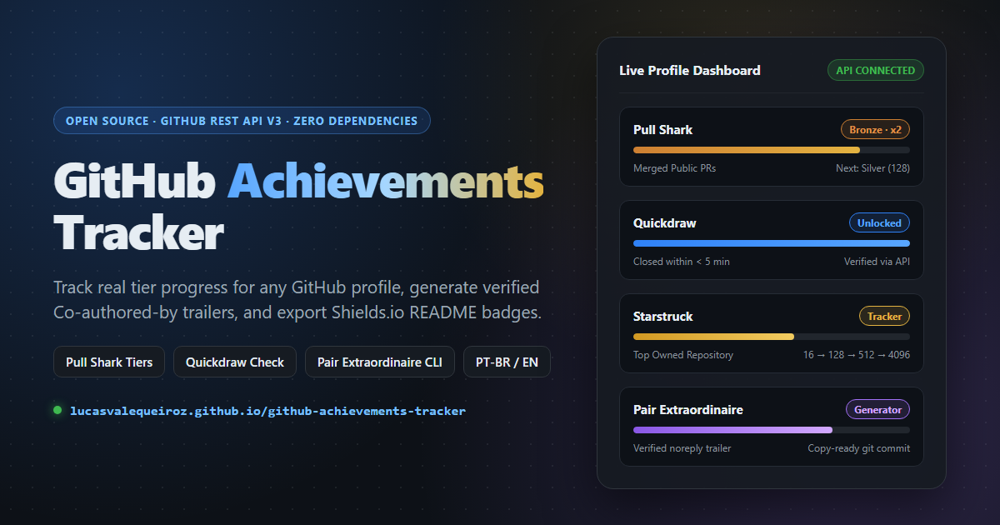

# 🏆 GitHub Achievements Tracker



[](https://github-achievement-tracker.vercel.app/)
[](https://lucasvalequeiroz.github.io/github-achievements-tracker/)
[](#local-development--tests)
[](#project-structure)
[](LICENSE)

Interactive dashboard, live SVG Profile README card generator, and open-source community tracker powered by the **GitHub REST API v3, GraphQL API, Vercel Serverless Functions, and GitHub Actions (IssueOps)** — zero runtime dependencies.

👉 **Try it live (Real-Time):** https://github-achievement-tracker.vercel.app/  
👉 **Check your own profile directly:** `https://github-achievement-tracker.vercel.app/?user=YOUR_USERNAME`  
👉 **Join the Open-Source Community Database in 1 click:** [➕ Register your profile](https://github.com/LucasValeQueiroz/github-achievements-tracker/issues/new?title=%5BRegister%5D+your-username&body=Replace+your-username+in+the+title+and+click+Submit+new+issue!)

---

## 🖼️ Live Dynamic SVG Card for Your Profile README

Paste this snippet into your GitHub Profile `README.md` (replace `YOUR_USERNAME` with your GitHub login) to display a live, auto-updating Achievements card:

```markdown
[](https://github-achievement-tracker.vercel.app/?user=YOUR_USERNAME)
```

**Live preview:**

[](https://github-achievement-tracker.vercel.app/?user=LucasValeQueiroz)

Supports query options: `theme=dark|light` and `lang=en|pt`.

---

## ✨ Features

- **Real-Time Multi-User Detection (No Visitor Token Needed):** Automatically tracks all 7 active GitHub Achievements (**Pull Shark**, **Starstruck**, **Quickdraw**, **YOLO**, **Pair Extraordinaire**, **Galaxy Brain**, and **Public Sponsor**) via `/api/achievements` + GitHub REST/GraphQL APIs.
- **Dynamic SVG Profile README Card (`/api/badge`):** Generates an always-fresh 495×195 SVG card for any GitHub username in dark or light mode.
- **Open-Source Community Database (IssueOps):** Visitors can register their profile in 1 click via GitHub Issues (`.github/workflows/register-user.yml`) and browse/filter/sort all registered profiles directly on the dashboard.
- **Browser Auto-Refresh & Smart Cache:** Auto-refreshes every 5 minutes and on tab focus (`visibilitychange`), backed by a 3-minute `sessionStorage` cache to protect against unauthenticated Search API rate limits.
- **Tier Progress & Recommendations:** Calculates exact remaining counts across **Default → Bronze → Silver → Gold** tiers and prioritizes the closest unlockable milestones.
- **Pair Extraordinaire Generator:** Resolves any real GitHub collaborator username into a verified `id+username@users.noreply.github.com` `Co-authored-by:` trailer and copy-ready `git commit` command.
- **Galaxy Brain Q&A Finder:** Detects primary languages from owned repositories and generates filtered GitHub Discussions search links for open, unanswered Q&A threads.
- **Shareable 1200×630 PNG/SVG Cards & Social Posts:** Exports dark/light cards and ready-to-share LinkedIn/X posts.
- **Pull Shark Pace Calculator & Side-by-Side Comparator:** Estimates target dates for Bronze/Silver/Gold and compares any two GitHub users live.
- **GitHub Flow CLI (`Ship-PR`):** Zero-dependency Node.js CLI (`scripts/ship-pr.mjs`) to turn everyday edits into branches + merged PRs with secret-file guardrails.
- **Bilingual & Accessible UI:** Instant **PT-BR / EN** language toggle and **Dark / Light** theme switcher.

---

## ⚡ Automatic Live Sync Architecture

1. **Real-Time Serverless Proxy (`api/achievements.js` & `api/badge.js`):** Runs on Vercel with server-side GraphQL + authenticated REST Search + public `?tab=achievements` parsing so every visitor gets live metrics in ~1 second without needing a token.
2. **GitHub Actions Multi-User Sync (`.github/workflows/sync-profiles.yml`):** Automatically refreshes all registered profiles in `data/tracked-users.json` into `data/profiles-snapshot.json` every 6 hours.
3. **IssueOps Community Registration (`.github/workflows/register-user.yml`):** Opening an issue titled `[Register] username` automatically validates the user, syncs their metrics, updates the database, comments with live links, and closes the issue.

---

## 🧪 Local Development & Tests

No build step or external packages are required — just Node.js 20+:

```bash
git clone https://github.com/LucasValeQueiroz/github-achievements-tracker.git
cd github-achievements-tracker

# Run unit tests (node:test)
npm test

# Preview locally
python -m http.server 8080
```

---

## 🤝 Contributing

Contributions are welcome! See [CONTRIBUTING.md](CONTRIBUTING.md) for guidelines, or ⭐ star the repository if this toolkit helps your GitHub profile.

## 📄 License

Released under the [MIT License](LICENSE).
